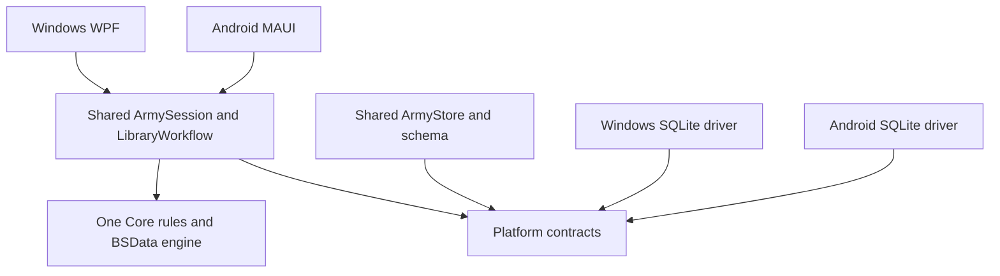

# Shared architecture and Android preparation

Windows and Android reference the same Core, Application and Persistence assemblies. There is one implementation of army rules, BSData interpretation, calculations, editing operations and import merging. Platform code supplies SQLite and operating-system services.

Supplemental display references now use the same shared architecture. `ReferenceCard.Details` carries canonical identity, edition, scope, multiple detachment targets, structured text and source ownership; the established per-card `SourceInfo` retains revision/date/hash. `ReferenceCoverage` records explicit completeness assertions. These are schema-2 dataset fields, stored in the existing SQLite source snapshots; schema-1 libraries remain readable. Unknown legacy editions remain unknown even if a later catalogue declares an edition.

`IReferenceSourceAdapter` has structured GrimList JSON and BSData catalogue implementations in Application. `LibraryWorkflow.PrepareReferenceImportAsync` parses streams, matches scope, previews a `ReferenceMerge` result and blocks unresolved source conflicts. Explicit Apply uses the existing atomic, stale-preview-checked transaction. Partial imports cannot delete missing records. Authoritative complete imports can retire only their own declared scope; tombstones remain available for provenance. Supplements never replace unit data, prices or saved armies. Source precedence is opt-in, with no implicit winner.

`DatasetSnapshot.References` indexes canonical cards and builds coverage once for each loaded dataset. `ArmyReferences.ForArmy` uses these indexes for edition/global/faction/selected-detachment filtering in both frontends. Equipment and unit commands do not read sources, parse, merge or rebuild reference coverage. Reference cards remain display information; Core's roster engine remains authoritative.

There is no Death Guard reference parser. Existing imported Death Guard text is portable input to the generic JSON adapter, preserving its original source. See [the reference format guide](../docs/runbooks/android/REFERENCE-LIBRARY-FORMAT.txt) for packs, completeness declarations, conflicts, matching and audit commands. Importer capability does not imply that a source supplies all factions' stratagem text.

The existing WPF frontend remains the desktop application. The mobile project now has a first reference-based interface: army tiles, faction/setup screens, a library/roster editor, unit datasheets, equipment and attachment controls, and rules/stratagem pages. Its Android build, deployment and launch pass on Medium_Phone_API_35. Runtime verification includes the imported library, shared rules and SQLite process-death restoration; see [the verification record](android-verification.md) for individual results and remaining checks.

## Initial inspection

Before extraction, `MainWindow` held the selected army, active dataset, selected entry and two undo stacks. It constructed new roster records for adding/removing/duplicating/resizing units and equipment changes, called attachment/enhancement operations, saved the result and recalculated during multiple render paths. Opening an army supplied missing loadouts, normalized mandatory choices, saved it and cleared history. The import dialogs coordinated acquisition, parsing, preview, impact calculation, application and repair.

Core already implemented the reusable models, rule modules, BSData interpreters, loadout constraints, attachment/association validation, pricing, dataset merging and export serialization. These algorithms were retained. The extraction changed their callers and assembly boundaries rather than adding a second rules interpretation.

The portability problems were `winsqlite3` P/Invoke in `SqliteStore`, Windows `pdftotext.exe` discovery/process execution in `MfmImporter`, WPF font APIs in `RosterPdf`, and frontend dialogs/clipboard access. The original SQLite wrapper and `ArmyStore` lived in the same file. Saves upserted armies and replaced ordered entries transactionally; imports appended complete JSON snapshots and switched `active_source`.

## Project dependencies

| Project | Owns | References |
| --- | --- | --- |
| `GrimList.Core` | Models, rules, validators, calculations, BSData interpretation, dataset merge/comparison, export serialization | .NET only |
| `GrimList.Platform` | Repository/SQLite contracts, editing-context record, platform paths, file selection/sharing, clipboard and PDF interfaces | Core |
| `GrimList.Persistence` | One `ArmyStore`, schema, migrations, source snapshots, army/context persistence | Platform and transitively Core |
| `GrimList.Application` | `ArmySession`, `ArmyWorkspace`, `LibraryWorkflow`, download clients and pricing-repair application | Platform and transitively Core |
| `GrimList.Platform.Windows` | Native Windows SQLite connection/factory, paths and PDF text extraction | Persistence and its contracts |
| `GrimList.Desktop` | Existing WPF screens, Windows dialogs, PDF rendering and clipboard adapter | Application and Windows adapters |
| `GrimList.Mobile` | MAUI Android composition, native Android SQLite connection, file/share/clipboard adapters and mobile presentation | Application, Persistence and MAUI |

`GrimList.slnx` builds Windows, shared libraries, tests and the data utility without an Android workload. `GrimList.Mobile.slnx` includes the Android frontend and the exact same shared projects.

## Shared editing and state

[`ArmySession`](../src/GrimList.Application/ArmySession.cs) owns the selected army, selected entry/model/loadout context, current calculated result, validation issues and undo/redo stacks. Attachments and enhancements remain selections on the shared army model. `INotifyPropertyChanged` exposes updated state to either frontend. Notifications use the calling thread; mobile dispatches presentation changes to the UI thread.

Named session operations include creating/opening/deleting/duplicating armies, adding/removing/duplicating/resizing units, choosing or adjusting equipment, resetting loadouts, attaching/detaching characters, selecting enhancements/warlords/detachments/dispositions and updating army metadata. Candidate filtering and library search use the same session/Core rules. No frontend maintains its own roster undo stack.

Commands validate supported increases, normalize required selections, calculate the result, and save before publishing new state or changing history. Undo snapshots are deep copies so subsequent nested equipment edits do not mutate history. A failed save leaves session state/history intact.

`MainWindow` delegates commands and uses the session's calculated result. Its remaining code builds WPF controls, groups rows, handles navigation, projects reference data and displays errors. Presentation can still call pure Core queries. It does not implement an alternative rule engine.

`ArmyWorkspace` owns a session, repository and import workflow. Mobile registers its workspace owner as an application singleton, not a page-scoped object. The WPF composition uses the same session and workflow types.

## Persistence and lifecycle

[`ArmyStore`](../src/GrimList.Persistence/ArmyStore.cs) accepts `ISqliteConnectionFactory`. The original tables and migrations remain. A new `editor_context` key in the existing `settings` table stores the selected army, entry, model index, loadout section and screen. Saving a committed army and its context occurs in one transaction. Repository operations serialize access to the connection.

Windows chooses `WindowsSqliteConnectionFactory`. Android chooses `AndroidSqliteConnectionFactory` using Android's SQLite API. Both execute the same repository SQL and serialize the same models; there is no mobile database schema fork. The Android prototype targets API 30 or later to support the SQLite UPSERT syntax already used by the repository. Large dataset JSON scalar reads avoid Android's cursor-window row-size limit, but real-catalogue memory/performance still needs device measurement.

`ArmySession.Restore` reloads the dataset and saved army from the repository, normalizes defaults, recalculates and restores valid editing context. Missing army/entry references are handled. Undo/redo history is deliberately session-local and starts empty after process recreation; committed roster changes survive. Unsaved text in a creation form is not a committed army.

Mobile initialization, commands, library reads, parsing, preview, apply and library refresh have asynchronous entry points. Long-running work runs away from the UI thread. Cancellation is checked before a database apply begins; an in-progress transaction finishes atomically. Importing a source does not silently apply it.

## Shared imports

[`LibraryWorkflow`](../src/GrimList.Application/LibraryWorkflow.cs) centralizes structured source reading, BSData archive import, downloads, merge previews, per-army impact calculation, stale-preview detection, apply and pricing repair. It accepts document streams, so Android content URIs do not need to masquerade as filesystem paths.

The WPF import dialog calls the shared workflow and renders the result. Its existing preview/apply event handlers remain synchronous wrappers over the shared service; Android uses `PrepareAsync` and `ApplyLibraryAsync`. Acquisition and full BSData parsing use asynchronous paths on both platforms.

`BsDataImporter.ImportAll`, dynamic/model constraints, association rules, nested selections, conditional modifiers and repeated price modifiers all remain in Core. The application regression checks compare the asynchronous archive pipeline with direct Core import, and existing rule regression checks remain in the suite.

PDF extraction lives behind `IPdfTextExtractor`; Windows supplies its existing external-tool implementation. Android supplies `AndroidPdfTextExtractor`, using native text-search coordinates on Android 15+ and the shared MFM column reader/parser. Selected document streams are copied into app cache for native PDF access and cleaned up afterward. Older Android versions can import JSON/text instead. `AndroidRosterPdf` implements `IRosterPdfExporter` with Android Canvas/PdfDocument, taking roster, loadout, attachment, enhancement and rule content from Core. Saving uses the Android document picker. Mobile composition injects these adapters into the existing workspace/interfaces; there is no second rules engine.

## Verification and remaining work

The extraction is covered by the existing Core tests, additional [`ApplicationChecks`](../tests/GrimList.Tests/ApplicationChecks.cs), and the native WPF smoke suite. Application checks exercise equipment, Leader/Support groups, enhancements, copy history, recreation through a new connection/session, rejected edits, injected save failures, SQLite transaction rollback, stale import previews, cancellation, stream imports and shared BSData semantics.

The earlier workload, Java selection and Android SDK blockers are resolved for the verified build using JDK 21, Android platform 36 and build-tools 36.0.0. The prototype runs on Android API 35 and uses the same shared services and rules as WPF. See [Android verification](android-verification.md) for runtime evidence, narrow fixes prompted by that testing, and the remaining acceptance procedure.

Initial Debug emulator timing observations are recorded with the runtime results. Physical-device performance and isolated parse, merge, recalculation and search benchmarks remain pending. The existing all-army fixtures verify correctness; they are not phone performance measurements.

The mobile presentation follows the supplied `docs/design/android-reference-images` layouts and Windows behaviour. `MainPage` has presentation files for Home/setup, Editor, Unit, Rules, Menu, Library and Export; `Ui` uses the desktop surface/input/text colours, and `MobilePalette` supplies faction colours. One top-right menu combines the desktop roster menu with Update from BSData, Build/Play mode and Army rules. Build mode displays all weapon alternatives; Play mode displays equipped profiles/counts. Attachment effects come from shared Core queries.

Library download/read/preview/apply use `LibraryWorkflow`. Text and Yellowscribe roster exports use the shared Core exporters. Android's `MobileDocumentSaver` writes through the native document provider's content URI using `ACTION_CREATE_DOCUMENT`; it requires no Windows path. The `.ros` MIME type preserves the roster extension instead of allowing the document picker to append `.xml`. Committed edits continue saving through `ArmySession`; the mobile-only Save army menu item was removed.

The WPF presentation and accepted shared architecture are unchanged. Final visual review, remaining desktop feature parity, accessibility/font-scale checks and physical-device profiling remain separate follow-up work.
