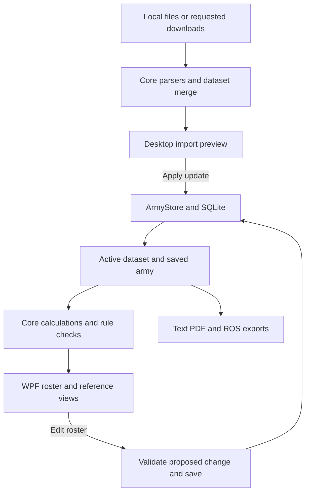

# How GrimList works

GrimList has Windows WPF and Android MAUI frontends over shared C# rules, application services and SQLite persistence. Both platforms have built and run; current release checks are recorded under `docs/distribution`. There is no application server or background synchronization service. See [AGENTS.md](../AGENTS.md) for the current build environment and [Shared architecture and Android](android-architecture.md) for the architecture history.

This guide maps behavior to the checked-in source. Start with [Using GrimList](user-guide.md) for the screen-by-screen workflow and [Data and storage](data-and-storage.md) for persisted formats.

## Project structure

| Location | Responsibility |
| --- | --- |
| `src/GrimList.Desktop` | WPF windows, input handlers, rendering, dialogs and PDF generation. |
| `src/GrimList.Core` | Data models, source interpretation, pricing, rule evaluation and export serialization. |
| `src/GrimList.Application` | Shared editing session, undo/redo, import workflows, acquisition and lifecycle orchestration. |
| `src/GrimList.Platform` | Repository, SQLite, files, paths, clipboard, sharing and PDF contracts. |
| `src/GrimList.Persistence` | Shared SQLite schema, migrations and repository implementation. |
| `src/GrimList.Platform.Windows` | Windows SQLite and PDF extraction adapters. |
| `src/GrimList.Mobile` | MAUI Android frontend and platform adapters. |
| `tools/GrimList.Data` | Console commands for data inspection, reference packages and targeted repairs. |
| `tests/GrimList.Tests` | Console regression harness using Core directly. |
| `scripts` | Additional reference-building and export/attachment verification tools. |
| `samples` | Historical demonstration data, imported only when explicitly chosen. |
| `pictureReferences` | UI design references. |
| `.local` | Launcher database, downloaded sources and generated local checks. |
| `artifacts` | Build and diagnostic outputs from development. |

Both frontends use Application and the same Core assembly. Persistence accepts an injected SQLite provider. Core has no WPF or native SQLite dependency and embeds two edition-specific core-stratagem JSON resources. The desktop/shared projects require no external NuGet packages; Mobile references MAUI Controls.

## Startup and application state

[`App.xaml.cs`](../src/GrimList.Desktop/App.xaml.cs) resolves `--data-dir`, creates `MainWindow` and optionally starts a desktop smoke check. [`MainWindow.xaml.cs`](../src/GrimList.Desktop/MainWindow.xaml.cs) selects the Windows repository adapter, constructs the shared `ArmySession`, wires home/setup events and displays the home screen. Closing commits pending fields through the session and disposes the database connection.

The interface uses XAML with event-driven code-behind. `MainWindow` is split across partial class files for loadouts, enhancements, leaders, references, effects, menus and errors. It reads the dataset, army, selected entry, history availability and calculated result from `ArmySession`. It rebuilds presentation through `Render`, `RefreshLibrary`, `RefreshDetails` and `RefreshRules`. Flags such as `rendering` prevent UI refresh events from being treated as user edits.

[`HomeView`](../src/GrimList.Desktop/HomeView.xaml.cs) lists, searches and emits actions for saved armies. [`ArmySetupView`](../src/GrimList.Desktop/ArmySetupView.xaml.cs) keeps the faction/detachment/name wizard state until completion. `MainWindow` saves the completed army and opens its roster.

## Domain objects

Most shared types are C# records in [`Models.cs`](../src/GrimList.Core/Models.cs). Code commonly constructs replacement records with `with` and new lists. Their nested lists are mutable types, so this convention is not a guarantee of deep immutability.

| Type | Meaning |
| --- | --- |
| `SourceInfo` | Source name, version, date, URL, import time, edition and content hash. |
| `Dataset` | The active collection of units, detachments and reference cards for a game. |
| `UnitDefinition` | One library unit: identity, price bands, provenance, profile and contextual costs. |
| `UnitProfile` | Characteristics, model/weapon profiles, abilities, keywords and imported structured rules. |
| `PointOption` | A model count and price beginning at a particular copy number. |
| `ArmyList` | A saved army: faction, limit, entries, detachments, disposition and warlord entry ID. |
| `ArmyEntry` | One selected instance of a library unit, with size, loadout, enhancement and attachment target. |
| `UnitLoadout` | Per-model roles/equipment and unit-level equipment selections. |
| `ReferenceCard` | Army/detachment rule, stratagem, enhancement or other reference with provenance. |
| `PricedEntry` | Calculated cost and breakdown for one roster entry. |
| `ArmyResult` | Calculated entries, known total, issues, completeness and validation status. |

A library unit and a roster entry are different things. Several entries can reference the same unit definition while keeping independent loadouts. Attachments point to another entry's ID; warlord selection also uses an entry ID. Definitions and current prices are resolved from the active dataset when needed.

## What happens when a unit is added

1. The frontend sends the selected library unit key and size to `ArmySession.AddUnit`, which checks availability and constructs an `ArmyEntry` with a new ID.
2. If structured equipment data exists, `Loadouts.Create` supplies the initial loadout.
3. `ArmySession.Commit` checks whether the proposed army increases an exceeded muster, enhancement or allied allowance.
4. Warlord, attachment and disposition normalization resolve supported automatic selections and dangling references.
5. The session calls `ArmyCalculator.Calculate` and compares the proposed issues with its cached result.
6. `ArmyStore.Save` persists the proposed army and editing context. Only after a successful save does the session push a deep copy of the previous state onto undo, clear redo, adopt the new state and notify the frontend.

Other roster operations use the same change path where applicable. A change can be saved while the army remains invalid, such as after reducing its points limit. Certain increases or selection operations are rejected immediately. This lets users build an incomplete list progressively without permitting every invalid addition.

Undo/redo saves the restored roster state back to SQLite. The stacks are in memory and are cleared when a roster opens or a library update applies. Library snapshots are a separate persistence mechanism, not part of roster undo.

## How pricing works

`ArmyCalculator.Calculate` iterates entries in stored roster order. For each entry it resolves the library unit and determines its copy number. Some imported rules count copies through a keyword category shared by several unit definitions.

The calculator obtains native or allied options through `UnitDefinition.PricesFor`, including applicable detachment additions. For the selected model count, it chooses the highest `FromCopy` threshold that does not exceed the entry's copy number. Where `PriceFormula` exists, `FormulaPricing` evaluates supported composition conditions against the actual selected model roles. `WargearPricing` adds selected equipment costs and `Enhancements` adds a purchased enhancement/upgrade.

For example, fictional five-model options of 80 points from copy 1 and 95 from copy 3 make three identical entries cost 80 + 80 + 95 = 255. Removing an entry recalculates copy positions; the remaining two cost 160. This behavior is exercised by the regression harness.

Prices use nullable integers. A missing size, unresolved formula, equipment cost or enhancement cost can produce an unknown entry total. `ArmyResult.Total` sums known entry totals, `Complete` requires every entry to have a price, and `Validated` requires both completeness and an empty issue list. Consumers must inspect these flags instead of treating a numerical total as proof that every unit was priced.

## Rule responsibilities

| Module | Responsibility |
| --- | --- |
| [`UnitAvailability`](../src/GrimList.Core/UnitAvailability.cs) | Whether a unit belongs in the army context and whether required detachments are selected. |
| [`MusterEffects`](../src/GrimList.Core/MusterEffects.cs) | Detachment nomination semantics, candidate counts, selected roster effects and effective per-entry keywords. Base datasheets remain immutable. |
| [`MusterRules`](../src/GrimList.Core/MusterRules.cs) | Copy limits, effective detachment-dependent keywords and supported muster checks. |
| [`WarlordRules`](../src/GrimList.Core/WarlordRules.cs) | Character candidates, mandatory selections and warlord validation. |
| [`DetachmentRules`](../src/GrimList.Core/DetachmentRules.cs) | Selected detachments, DP costs/budgets, dispositions and compatibility with legacy selections. |
| [`AlliedRules`](../src/GrimList.Core/AlliedRules.cs) | Explicitly implemented allied permissions, library visibility, subtotals and allowances. |
| [`Enhancements`](../src/GrimList.Core/Enhancements.cs) | Bearer restrictions, selected-detachment choices, pricing, upgrade grouping and attached-unit slots. |
| [`LeaderRules`](../src/GrimList.Core/LeaderRules.cs) and its partial files | Bodyguard eligibility, structured attachment permissions and complete-group validation. |
| [`AssociationRules`](../src/GrimList.Core/AssociationRules.cs) | Imported association-count constraints and their conditional modifiers. |
| [`RuleEvaluation`](../src/GrimList.Core/RuleEvaluation.cs) | Shared evaluation of structured supported conditions. |
| [`Loadouts`](../src/GrimList.Core/Loadouts.cs) and [`LoadoutOptions`](../src/GrimList.Core/LoadoutOptions.cs) | Defaults, resizing, model/equipment counts, constraints and selected weapon/ability projection. |

These modules combine imported metadata with application-defined rule support. For example, allied routes are explicitly implemented, and some rule text is interpreted using recognized wording patterns. Importing arbitrary rules does not make them executable. Unrecognized conditions can produce warnings or leave a choice unavailable.

The enhancement budget includes an explicitly provisional six-choice value for games through 3,000 points. The documentation of an implemented allowance should not be mistaken for independent verification of the game rule.

`ReferenceCard.Eligibility` retains supported BSData enhancement visibility conditions independently of display text. `BsDataEnhancements` preserves Boolean groups, keyword exclusions, named bearer source identities and detachment conditions. `Enhancements` evaluates these against the bearer, alongside existing character, Epic Hero, allied and textual restrictions. Unsupported conditions cannot grant eligibility.

`EnhancementLibraryRepair` runs when a session loads a library. It restores only missing enhancement eligibility, matching source edition/hash, faction, detachment, name, cost and exact rule text. It can re-read an exact cached catalogue or use the compact bundled recovery metadata for revision `da7248777da54218034f09b6271ad89ff6b68a77`, including libraries transferred as JSON without a source cache. The bundle contains conditions and text hashes, not replacement rules. The repaired snapshot is persisted through the repository; unit data and saved selections are preserved. New catalogue imports read the conditions directly.

The recovery bundle is generated from `BsDataImporter.ImportEnhancementReferences`. The regression harness's `--enhancement-catalogue <repository.zip> <library.json>` check emits `enhancement-repair-pack.json`; `python scripts/build_enhancement_recovery.py <pack.json> src/GrimList.Application/Resources/enhancement-recovery.json.gz` creates the deterministic embedded resource. The same check verifies bundled recovery against fresh extraction and rejects source/text mismatches.

## Loadouts and attachment groups

`LoadoutDefinition` describes model roles, equipment groups/options and minimum/maximum bounds. `UnitLoadout` records what one army entry actually selected. This separation lets the same datasheet support different roster configurations and lets a refresh report choices that no longer match the definition.

`Loadouts.Create`, `Resize`, `Choose`, `SetRoleCount` and `SetOptionCount` implement editing. The desktop translates grouped quantity controls into model selections. Equipped-weapon projection keeps related firing profiles together. When structured definitions are absent, the app offers a manual fallback rather than inferring full replacement rules from a flat weapon list.

Attachment imports retain explicit bodyguard targets and recognized exceptions in `AttachmentDefinition`, together with structural `AssociationDefinition` data. Permission can come from either character or from a bodyguard modifier. `LeaderRules.CombinationProblem` checks the complete proposed set, so the result should not depend on which eligible character was attached first.

The UI pickers call the same Core rules used by validation. Removing a bodyguard clears dangling attachment targets during normalization. Whole-army duplication remaps all entry IDs and references; single-entry duplication clears the copied entry's attachment target.

## Reference views and calculated effects

[`ArmyReferences.ForArmy`](../src/GrimList.Core/ArmyReferences.cs) selects cards by faction, selected detachment and compatible edition. It adds bundled core stratagem cards for recognized editions. An imported core card with the same normalized identity overrides the bundled one.

[`AttachedEffects`](../src/GrimList.Core/AttachedEffects.cs) derives recognized weapon adjustments from relevant abilities. [`EnhancementDefences`](../src/GrimList.Core/EnhancementDefences.cs), [`DatasheetStats`](../src/GrimList.Core/DatasheetStats.cs), [`AbilityGroups`](../src/GrimList.Core/AbilityGroups.cs) and [`WeaponRuleReference`](../src/GrimList.Core/WeaponRuleReference.cs) prepare defensive statistics, grouped abilities and keyword explanations.

The desktop's `MainWindow.Effects.cs` keeps the temporary Afflicted-target preview state and labels applied effects. These are display calculations. They do not rewrite imported weapon profiles or saved loadouts, and unsupported effects remain readable rule text.

Play mode changes the layout and selected-equipment projection. It is not a battle simulation or battle-state persistence layer.

## Import and export boundaries

[`LibraryWorkflow`](../src/GrimList.Application/LibraryWorkflow.cs) orchestrates acquisition, parsing, merge preview and explicit application. [`ImportWindow`](../src/GrimList.Desktop/ImportWindow.xaml.cs) supplies Windows file dialogs and displays the shared results. Core handles source interpretation. Background import work uses cancellation tokens; frontend controls are updated through their UI context. A failed or cancelled acquisition does not apply a dataset. See the [import pipeline](data-and-storage.md#import-pipeline).

[`RosterExport`](../src/GrimList.Core/RosterExport.cs) produces text; [`YellowscribeExport`](../src/GrimList.Core/YellowscribeExport.cs) serializes compatible XML and contains its upload client. [`RosterPdf`](../src/GrimList.Desktop/RosterPdf.cs) is in Desktop because it uses Windows text/layout facilities. [`ExportWindow`](../src/GrimList.Desktop/ExportWindow.xaml.cs) handles file dialogs, clipboard copying and explicit upload.

Exports calculate validation from the supplied army and dataset. They do not silently select a warlord to make the exported list pass. Normal editing and saving can perform that automatic selection earlier.

## Where to start when changing a feature

| Change | Read first |
| --- | --- |
| Layout, menus or a screen action | Relevant XAML and its code-behind; the matching `MainWindow` partial. |
| Incorrect roster total | `ArmyCalculator` in `Models.cs`, then `FormulaPricing` or `WargearPricing`; inspect the imported definition. |
| Missing imported unit or profile | `BsDataArmies`, `BsDataImporter`, `BsDataProfiles` and the original catalogue dependencies. |
| Incorrect equipment choice or bound | `BsDataLoadouts`, `BsDataModelConstraints`, `Loadouts` and `LoadoutOptions`. |
| Rejected attachment | `LeaderRules` partials, `AssociationRules`, imported attachment/association metadata. |
| Saved data or update behavior | `ArmyStore`, `ArmySession`, `LibraryWorkflow` and `DatasetMerge`. |
| Export mismatch | The format-specific exporter and corresponding Core/desktop export checks. |

Use [Development and testing](development.md) for the commands and existing checks associated with these areas.
